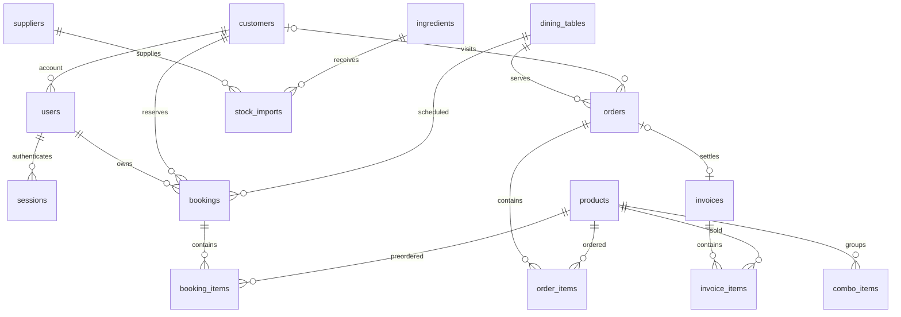

# Database RestMan

Database mặc định: `data/restman.sqlite`. Sử dụng SQLite tích hợp của Node.js 24, chế độ WAL, bật foreign keys và timeout khóa 5 giây. Mỗi thao tác nghiệp vụ nhiều bước dùng `BEGIN IMMEDIATE` / `COMMIT` và rollback khi lỗi.

Schema đầy đủ nằm trong `database/schema.sql`, dữ liệu mẫu nằm trong `backend/seed.cjs`. Schema version hiện tại là 1, lưu trong `PRAGMA user_version`. Khởi động hoặc lệnh init chỉ tạo dữ liệu lần đầu; không xóa dữ liệu cũ.

## Các bảng

| Bảng | Nội dung |
| --- | --- |
| `users` | Tài khoản, vai trò, password hash scrypt, liên kết khách hàng |
| `sessions` | Hash token phiên, tài khoản, thời hạn |
| `customers` | Khách hàng và thẻ thành viên, số điện thoại duy nhất |
| `products` | Món ăn và combo, giá hiện tại, trạng thái phục vụ/xóa mềm |
| `combo_items` | Liên kết combo với các món |
| `suppliers` | Nhà cung cấp |
| `ingredients` | Nguyên liệu, đơn vị, tồn hiện tại, ngưỡng tồn tối thiểu |
| `stock_imports` | Phiếu nhập từng nguyên liệu theo nhà cung cấp và người nhập |
| `dining_tables` | Bàn và sức chứa |
| `orders` | Lượt phục vụ tại bàn, khách hàng, trạng thái và phiên bản |
| `order_items` | Các món/combo của lượt phục vụ, snapshot giá và tên |
| `invoices` | Hóa đơn đã thanh toán, tổng tiền và phương thức |
| `invoice_items` | Chi tiết hóa đơn, snapshot giá và tên |
| `bookings` | Đặt bàn thuộc tài khoản khách, thời gian, bàn, trạng thái |
| `booking_items` | Món đặt trước, snapshot giá và tên |

Các ràng buộc đáng chú ý: một bàn có tối đa một lượt phục vụ đang mở (partial unique index), một lượt phục vụ có tối đa một hóa đơn, số lượng món từ 1 đến 99, giá dương, tồn kho không âm, phone/username không trùng. Các trường khóa ngoại được kiểm tra bởi SQLite.

## Quan hệ



Hóa đơn mẫu có `order_id = NULL`, vì chỉ có lịch sử hóa đơn, không có lượt phục vụ đang diễn ra từ dữ liệu demo. Hóa đơn mới luôn được tạo từ lượt phục vụ.

## Khởi tạo, kiểm tra, sao lưu

```sh
node scripts/database.cjs init
node scripts/database.cjs info
node scripts/database.cjs backup
```

Lệnh backup dùng SQLite Online Backup API, tạo một file mới trong `data/backups`, không ghi đè bản sao cũ. Có thể truyền đường dẫn đích ở tham số tiếp theo. Bản backup bao gồm dữ liệu và thông tin tài khoản; cần bảo quản như database chính.

Khôi phục: dừng máy chủ bằng Ctrl+C, giữ lại database hiện tại để dự phòng, rồi đặt bản backup vào đường dẫn `RESTMAN_DB` hoặc `data/restman.sqlite`. Không thay file database trong lúc máy chủ đang chạy.

Chưa quản lý định lượng nguyên liệu theo công thức; bán món chưa tự trừ tồn kho. Tồn kho tăng từ phiếu nhập. Thêm trừ kho cần bổ sung công thức món, tồn đầu kỳ và nghiệp vụ xuất kho.
